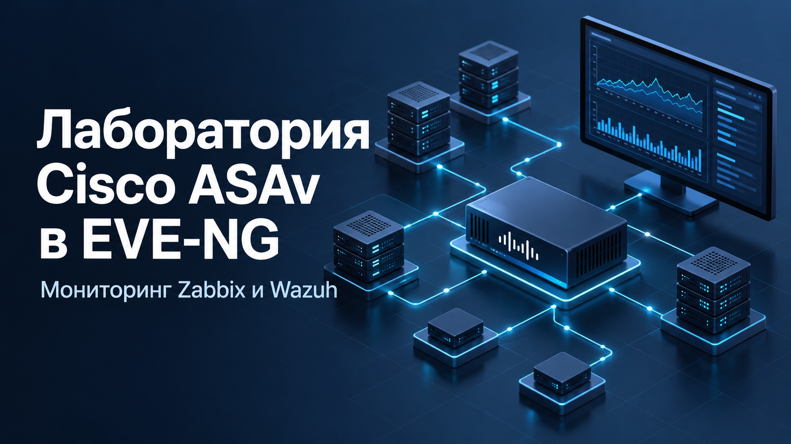

# Лаборатория Cisco ASAv в EVE-NG

Лаборатория для отработки правил доступа Cisco ASAv, сбора Syslog в Wazuh, построения дашбордов и проверки оповещений. Zabbix и Wazuh размещаются на общей виртуальной машине CentOS; Cisco ASAv работает внутри EVE-NG.

## Материалы

- [Полная статья с иллюстрациями](article.md)
- [Оформленная статья в Word](documents/article.docx)
- [Обложка](assets/cover.png)

## Состав лаборатории

| Компонент | Назначение |
| --- | --- |
| CentOS с Zabbix и Wazuh | Мониторинг и обработка событий |
| EVE-NG с Cisco ASAv | Виртуальная сетевая лаборатория |
| PC-IN и PC-OUT | Проверка разрешённого и заблокированного трафика |
| VMware VMnet1 | Лабораторная сеть Host-only |
| VMware VMnet8 | Доступ в интернет через NAT |

## Содержание

Подготовка CentOS и firewalld; установка Zabbix, PostgreSQL, Nginx и Wazuh; развёртывание EVE-NG и ASAv; приём Syslog и индексация архива; создание дашбордов; проверка ACL и правил корреляции Wazuh.

Команды и скрипты перенесены из авторского документа без изменений. Замечания к исходным HTML-сущностям и переносам в коде вынесены в [отдельный файл](EDITORIAL_NOTES.md).

В репозитории находятся статья, обложка и иллюстрации. Образы операционных систем и Cisco ASAv в комплект не включены.
