# Лаборатория Cisco ASAv в EVE-NG с мониторингом Zabbix и Wazuh


В статье рассмотрено развёртывание лаборатории Cisco ASAv в EVE-NG, подготовка сервера Zabbix и Wazuh, сбор сообщений Syslog, построение дашбордов и проверка оповещений о блокировках трафика.

## Состав лаборатории

ВМ № 1 — Zabbix и Wazuh для мониторинга и обработки событий.

ВМ № 2 — EVE-NG для запуска Cisco ASAv.

VMnet1 в режиме Host-only — связь ноутбука, обеих виртуальных машин и ASA.

VMnet8 в режиме NAT — доступ виртуальных машин в интернет для установки пакетов.

## Подготовка сервера CentOS 10

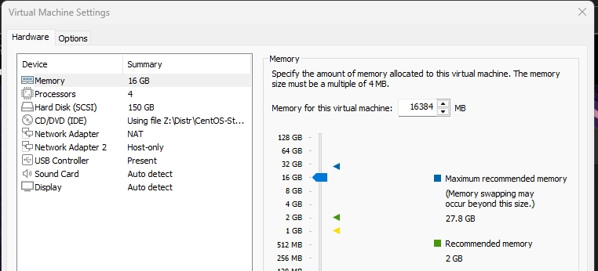

*Параметры виртуальной машины в VMware*

### Настройка сетевого интерфейса

```text
# Создаём профиль внутреннего адаптера со статическим адресом.
sudo nmcli connection add \
  type ethernet \
  ifname ens36 \
  con-name LAB-SYSLOG \
  ipv4.method manual \
  ipv4.addresses 192.168.179.20/24

# Запрещаем использовать внутреннее подключение для маршрута по умолчанию.
# Включаем автоматическое подключение при загрузке ОС.
sudo nmcli connection modify LAB-SYSLOG \
  ipv4.never-default yes \
  ipv6.never-default yes \
  connection.autoconnect yes

# Активируем созданное подключение.
sudo nmcli connection up LAB-SYSLOG
```

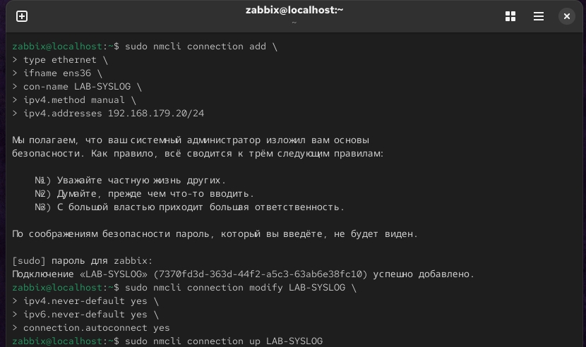

*Применение команд*

### Обновление системы и установка служебных пакетов

```text
# Обновляем установленные пакеты CentOS.
sudo dnf upgrade --refresh -y

# Устанавливаем инструменты администрирования и диагностики.
sudo dnf install -y \
  curl wget vim-enhanced \
  tar unzip \
  chrony \
  open-vm-tools \
  openssh-server \
  firewalld \
  policycoreutils-python-utils \
  tcpdump bind-utils

# Включаем службу интеграции гостевой ОС с VMware.
sudo systemctl enable --now vmtoolsd

# Включаем SSH для подключения к серверу с ноутбука.
sudo systemctl enable --now sshd

# Включаем межсетевой экран. 
sudo systemctl enable --now firewalld 
```

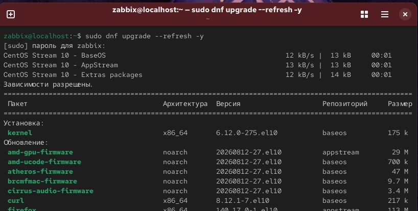

*Применение команд*

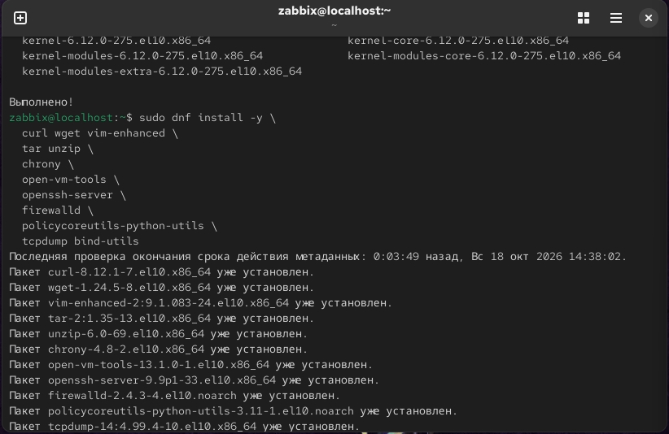

*Применение команд*

Назначение пакетов:

open-vm-tools обеспечивает взаимодействие CentOS с VMware.

chrony синхронизирует время.

tcpdump позволяет проверить поступление сообщений Syslog от ASA.

bind-utils помогает проверять DNS.

policycoreutils-python-utils используется для управления параметрами SELinux.

После обновления ядра перезагрузите ВМ:

```text
# Перезагружаем сервер для запуска обновлённого ядра. 
sudo reboot
```

### Имя сервера и синхронизация времени

```text
# Задаём понятное имя общего сервера мониторинга.
sudo hostnamectl set-hostname zabbix-wazuh

# Устанавливаем часовой пояс Иркутска.
sudo timedatectl set-timezone Asia/Irkutsk

# Включаем синхронизацию времени через chrony.
sudo systemctl enable --now chronyd

# Проверяем часовой пояс и состояние синхронизации.
timedatectl

# Проверяем используемые источники времени.
chronyc sources -v

# Проверяем состояние системных часов. 
chronyc tracking
```

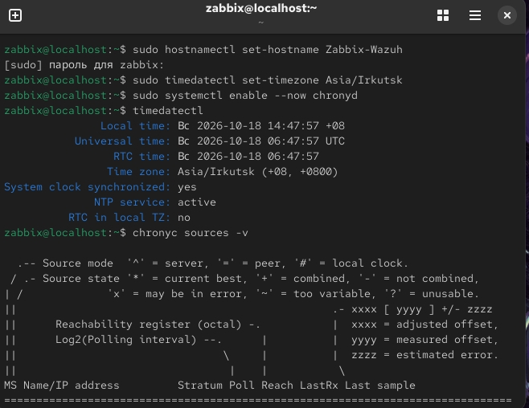

*Применение команд*

### Проверка включённого SELinux

```text
# Показываем текущий режим SELinux.
getenforce

# Показываем подробное состояние SELinux. 
sestatus
```

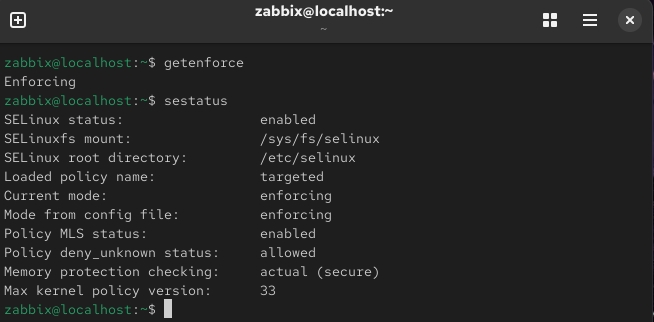

*Применение команд*

### Проверка параметра ядра для Wazuh Indexer

```text
# Проверяем предел количества областей отображения памяти. 
sysctl vm.max_map_count
```

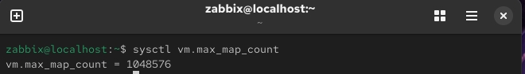

*Применение команд*

Для индексатора значение должно быть не менее 262144. Если оно уже выше, уменьшать его не нужно. [Требование Wazuh Indexer](https://wazuh.github.io/wazuh-indexer-plugins/ref/configuration/index.html).

Если значение ниже:

```text
# Сохраняем настройку, чтобы она действовала после перезагрузки.
echo 'vm.max_map_count=262144' | \
  sudo tee /etc/sysctl.d/99-wazuh-indexer.conf

# Применяем созданный файл.
sudo sysctl -p /etc/sysct
l.d/99-wazuh-indexer.conf

# Проверяем результат. sysctl vm.max_map_count
```

Это ограничение числа отображений памяти, а не объём выделяемой оперативной памяти.

## Настройка межсетевого экрана firewalld

```text
# Создаём постоянную зону для лабораторной сети.
sudo firewall-cmd --permanent --new-zone=lab-syslog

# Входящие подключения разрешаются только явно добавленными правилами. 
sudo firewall-cmd --permanent --zone=lab-syslog --set-target=DROP
```

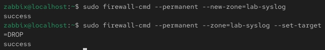

*Применение команд*

### Доступ с внешнего узла

В данном примере внешним узлом администрирования является ноутбук.

```text
# Разрешаем SSH с ноутбука для администрирования CentOS.
sudo firewall-cmd --permanent --zone=lab-syslog \
  --add-rich-rule='rule family="ipv4" source address="192.168.179.1/32" port port="22" protocol="tcp" accept'

# Разрешаем доступ с ноутбука к будущему веб-интерфейсу Zabbix.
sudo firewall-cmd --permanent --zone=lab-syslog \
  --add-rich-rule='rule family="ipv4" source address="192.168.179.1/32" port port="80" protocol="tcp" accept'

# Разрешаем доступ с ноутбука к будущему Wazuh Dashboard.
sudo firewall-cmd --permanent --zone=lab-syslog \
  --add-rich-rule='rule family="ipv4" source address="192.168.179.1/32" port port="443" protocol="tcp" accept'
```

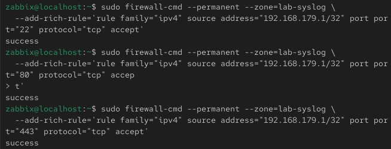

*Применение команд*

### Приём Syslog от ASA и проверка связи

```text
# Разрешаем ASA с адресом 192.168.179.30 отправлять Syslog на UDP 514.
sudo firewall-cmd --permanent --zone=lab-syslog \
  --add-rich-rule='rule family="ipv4" source address="192
.168.179.30/32&quot; port port="514" protocol="udp" accept'

# Разрешаем ping из лабораторной подсети для проверки связности.
sudo firewall-cmd --permanent --zone=lab-syslog \  --add-rich-rule='rule family="ipv4" source address="192.168.179.0/24" icmp-type name="echo-request" accept'
```

Разрешение UDP 514 подготавливает межсетевой экран. Сам приём сообщений включим позже в Wazuh.

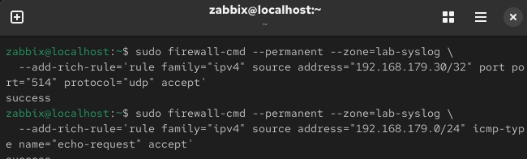

*Применение команд*

### Применение правил и назначение зоны

```text
# Проверяем сохранённую конфигурацию firewalld.
sudo firewall-cmd --check-config

# Загружаем созданную зону и её правила.
sudo firewall-cmd --reload

# Сохраняем привязку зоны в профиле внутреннего адаптера.
sudo nmcli connection modify LAB-SYSLOG connection.zone lab-syslog

# Повторно активируем профиль с новой привязкой.
sudo nmcli connection up LAB-SYSLOG
```

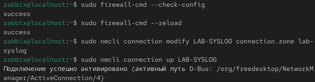

*Применение команд*

### Порты Zabbix и Wazuh и подготовка к подключению KSC

| Порт | Протокол | Кто → куда | Назначение |
| --- | --- | --- | --- |
| 22 | TCP | Ноутбук → CentOS / EVE-NG | Администрирование по SSH |
| 80 | TCP | Ноутбук → CentOS | Веб-интерфейс Zabbix |
| 80 | TCP | Ноутбук → EVE-NG | Веб-интерфейс EVE-NG при HTTP |
| 443 | TCP | Ноутбук → CentOS | Wazuh Dashboard |
| 514 | UDP | ASA → CentOS | Прямая отправка Syslog в Wazuh |
| 1514 | TCP | Агенты Wazuh → CentOS | Передача событий и результатов проверок ОС |
| 1515 | TCP | Агенты Wazuh → CentOS | Регистрация агентов |
| 10050 | TCP | Сервер Zabbix → контролируемая ОС | Пассивные проверки Zabbix Agent / Agent 2 |
| 10051 | TCP | Активные агенты Zabbix → CentOS | Передача данных мониторинга |
| 123 | UDP | ASA / EVE-NG → CentOS | Синхронизация времени, если CentOS назначен NTP-сервером |
| 161 | UDP | Сервер Zabbix → ASA | Опрос ASA по SNMP, если включим |
| 162 | UDP | ASA → CentOS | Приём SNMP traps, если включим |

Для Wazuh Agent входящие порты на контролируемой ОС обычно не требуются: агент устанавливает соединение с менеджером. Для пассивного Zabbix Agent TCP 10050 разрешается на контролируемой ОС от адреса 192.168.179.20. [Документация Wazuh](https://documentation.wazuh.com/current/getting-started/architecture.html), [документация Zabbix](https://www.zabbix.com/documentation/7.4/en/manual/installation/requirements), [SNMP traps](https://www.zabbix.com/documentation/7.4/en/manual/config/items/itemtypes/snmptrap).

#### Компоненты внутри общей виртуальной машины CentOS

| Порт | Протокол | Кто → куда | Доступ |
| --- | --- | --- | --- |
| 5432 | TCP | Zabbix Server и веб-интерфейс → PostgreSQL | Локально |
| 9200 | TCP | Filebeat и Wazuh Dashboard → Wazuh Indexer | Локально |
| 55000 | TCP | Wazuh Dashboard → Wazuh Manager API | Локально |
| 10050 | TCP | Zabbix Server → собственный агент CentOS | Локально |
| 10051 | TCP | Веб-интерфейс Zabbix → Zabbix Server | Локально |

### Порты для последующего подключения Kaspersky Security Center

| Порт | Протокол | Кто → куда | Назначение |
| --- | --- | --- | --- |
| 13000 | TCP, TLS | Network Agent → сервер KSC | Основной канал управления |
| 13000 | UDP | Network Agent → сервер KSC | Уведомления о выключении устройств |
| 15000 | UDP | KSC → Network Agent | Управляющие сигналы агентам |
| 8080 | TCP, HTTPS | Ноутбук → KSC Web Console | Веб-консоль |
| 13299 | TCP, TLS | Web Console / IAM → сервер KSC | Управление через OpenAPI |
| 13291 | TCP, TLS | Консоль / средства автоматизации → KSC | Зависит от версии и способа управления |
| 8061 | TCP, HTTPS | Клиенты → сервер публикации пакетов | Загрузка установочных пакетов |
| 514 | UDP или TCP | KSC → Wazuh | Экспорт событий; транспорт согласуем с приёмником |

Пример адресации: KSC — 192.168.179.40, Wazuh — 192.168.179.20. Адрес .40 указан условно.

Команды выполняются на CentOS с Wazuh, после создания зоны lab-syslog:

```text
# Разрешаем серверу KSC отправлять Syslog
# на TCP 514 сервера Wazuh.
sudo firewall-cmd --permanent --zone=lab-syslog \
  --add-rich-rule='rule family="ipv4" source address="192.168.179.40/32" destination address=&q
uot;192.168.179.20/32" port port="514" protocol="tcp" accept'

# Проверяем правильность сохранённой конфигурации.
sudo firewall-cmd --check-config

# Применяем правило.
sudo firewall-cmd --reload

# Показываем действующие адресные правила зоны. sudo firewall-cmd --zone=lab-syslog --list-rich-rules
KSC 192.168.179.40 → Wazuh 192.168.179.20:514/TCP
```

/32 ограничивает разрешение одним IP-адресом. Для фактического приёма событий позже включим TCP-приёмник Wazuh и добавим IP KSC в allowed-ips.

```text
sudo bash -c '
set -e

# Функция добавляет разрешение: источник, порт назначения, протокол.
allow() {
  firewall-cmd --permanent --zone=lab-syslog \
    --add-rich-rule="rule family=\"ipv4\" source address=\"$1\" destination address=\"192.168.179.20/32\" port port=\"$2\" protocol=\"$3\" accept"
}

# SSH, Zabbix Web и Wazuh Dashboard — доступ с ноутбука.
for port in 22 80 443; do
  allow 192.168.179.1/32 "$port" tcp
done

# Агенты Wazuh и активные агенты Zabbix — лабораторная подсеть.
for port in 1514 1515 10051; do
  allow 192.168.179.0/24 "$port" tcp
done

# Syslog от Cisco ASA.
allow 192.168.179.30/32 514 udp

# Syslog от будущего KSC: замени адрес фактическим.
allow 192.168.179.40/32 514 tcp

# NTP для EVE-NG и ASA — подготовка к настройке сервера времени.
allow 192.168.179.10/32 123 udp
allow 192.168.179.30/32 123 udp

# Проверяем конфигурацию, применяем и показываем результат.
firewall-cmd --check-config
firewall-cmd --reload
firewall-cmd --zone=lab-syslog --list-all
'
```

TCP 10050 открывается на удалённых ОС с агентом Zabbix, поскольку сервер подключается к ним. PostgreSQL 5432, Wazuh Indexer 9200 и API 55000 в нашей схеме работают локально.

Открытие портов подготавливает межсетевой экран; сами службы настроим при установке.

## Установка Zabbix 7.4 с PostgreSQL и Nginx

Первый этап — установить пакеты. Они доступны в [официальном репозитории Zabbix для CentOS Stream 10](https://repo.zabbix.com/zabbix/7.4/stable/centos/10/x86_64/).

### Подключение репозитория Zabbix

```text
# Устанавливаем описание официального репозитория Zabbix 7.4.
sudo rpm -Uvh https://repo.zabbix.com/zabbix/7.4/release/centos/10/noarch/zabbix-release-latest-7.4.el10.noarch.rpm

# Очищаем старые сведения о репозиториях. 
sudo dnf clean all
```

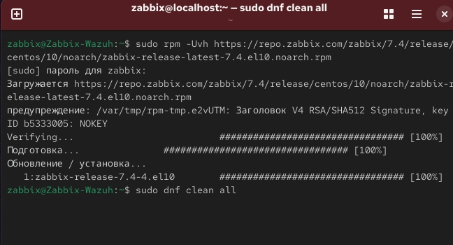

*Применение команд*

### Установка компонентов

```text
# Устанавливаем сервер Zabbix, веб-интерфейс для PostgreSQL,
# конфигурацию Nginx, SQL-схему, политику SELinux,
# агент и инструмент проверки агента.
# Также устанавливаем PostgreSQL, Nginx и PHP-FPM.
sudo dnf install --refresh -y \
  zabbix-server-pgsql \
  zabbix-web-pgsql \
  zabbix-nginx-conf \
  zabbix-sql-scripts \
  zabbix-selinux-policy \
  zabbix-agent2 \
  zabbix-get \
  postgresql-server \
  postgresql \
  nginx \
  php-fpm
```

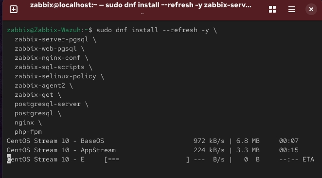

*Применение команд*

### Проверка установленных версий

```text
# Проверяем наличие основных пакетов и их версии.
rpm -q \
  zabbix-server-pgsql \
  zabbix-web-pgsql \
  zabbix-nginx-conf \
  zabbix-agent2 \
  postgresql-server \
  nginx \ 
php-fpm
```

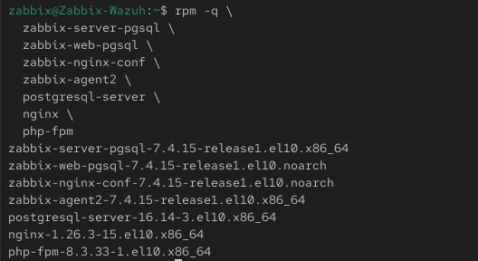

*Применение команд*

Ожидаем Zabbix 7.4.x и PostgreSQL 16.x. PostgreSQL 16 устанавливается стандартным пакетом postgresql-server. [Документация Red Hat](https://docs.redhat.com/en/documentation/red_hat_enterprise_linux/10/html/configuring_and_using_database_servers/using-postgresql).

### Создание базы PostgreSQL и загрузка начальной схемы

#### Инициализация PostgreSQL

```text
# Создаём начальную структуру PostgreSQL.
sudo postgresql-setup --initdb

# Запускаем PostgreSQL и включаем автоматический запуск после перезагрузки.
sudo systemctl enable --now postgresql

# Проверяем состояние: ожидается active. 
systemctl is-active postgresql
```

Это штатный порядок установки PostgreSQL в системе. [Документация Red Hat](https://docs.redhat.com/en/documentation/red_hat_enterprise_linux/10/html/configuring_and_using_database_servers/using-postgresql).

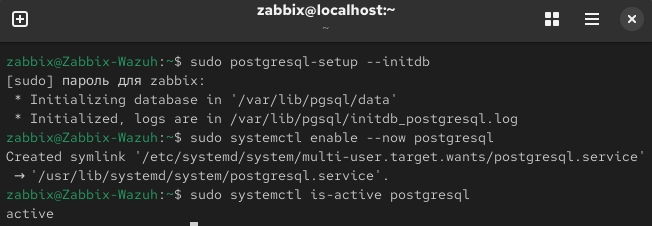

*Применение команд*

#### Создание пользователя базы данных

```text
# Создаём пользователя PostgreSQL для Zabbix.
# Он сможет работать со своей базой без прав администратора PostgreSQL.
sudo -u postgres createuser \
  --pwprompt \
  --no-superuser \
  --no-createdb \
  --no-createrole \ 
 zabbix
```

Будет предложено дважды ввести новый пароль пользователя базы zabbix. Символы при вводе не отображаются.

Сохраните этот пароль: он понадобится для подключения Zabbix Server и веб-интерфейса.

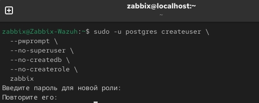

#### Создание базы данных

```text
# Создаём базу zabbix в кодировке UTF-8.
# Владельцем назначаем созданного пользователя zabbix.
sudo -u postgres createdb \
  --owner=zabbix \
  --encoding=UTF8 \
  --template=template0 \ 
 zabbix
```

Создание пользователя и базы соответствует схеме из [документации Zabbix](https://www.zabbix.com/documentation/7.4/en/manual/appendix/install/db_scripts).

#### Загрузка начальной схемы

```text
# Распаковываем SQL-файл из установленного пакета Zabbix.
# Создаём таблицы и загружаем начальные данные от имени владельца базы.
# При ошибке останавливаем импорт и откатываем эту транзакцию.
zcat /usr/share/zabbix/sql-scripts/postgresql/server.sql.gz | \
  sudo -u zabbix psql \
    -X \
    --single-transaction \
    --set=ON_ERROR_STOP=1 \ 
 --dbname=zabbix
```

#### Проверка базы данных

```text
# Проверяем имя базы, кодировку и владельца.
sudo -u postgres psql -X -c \
  "SELECT datname, pg_encoding_to_char(encoding) AS encoding,
          pg_get_userbyid(datdba) AS owner
   FROM pg_database WHERE datname = 'zabbix';
"

# Проверяем наличие таблицы с версией схемы Zabbix.
sudo -u postgres psql -X -d zabbix -c \  "SELECT * FROM dbversion;"
```

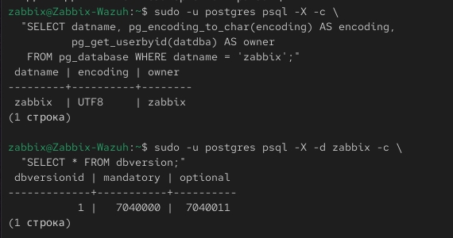

*Применение команд*

### Настройка авторизации PostgreSQL

```text
# Открываем правила подключения к PostgreSQL. 
sudo vim /var/lib/pgsql/data/pg_hba.conf
```

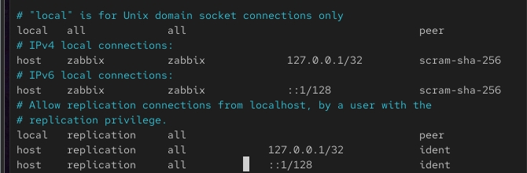

*Правила авторизации PostgreSQL*

В Vim: i — редактировать; затем Esc, :wq, Enter — сохранить и выйти.

Переключите раскладку клавиатуры на английскую.

Нажмите клавишу Esc — выйдете из режима редактирования.

Наберите :wq. Двоеточие вводится сочетанием Shift + ;, затем буквы w и q.

Нажмите Enter.

Порядок важен: PostgreSQL использует первое подходящее правило. [Документация PostgreSQL](https://www.postgresql.org/docs/16/auth-pg-hba-conf.html).

```text
# Применяем правила подключения без остановки базы. 
sudo systemctl reload postgresql
```

#### Проверка входа по паролю

```text
# Проверяем подключение по TCP именно под пользователем базы zabbix.
psql -h 127.0.0.1 -U zabbix -d zabbix -W \ 
 -c "SELECT current_user, current_database();"
```

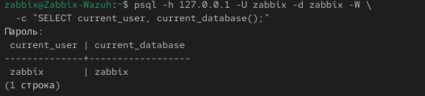

### Настройка Zabbix Server

```text
# Открываем основную конфигурацию сервера мониторинга.
sudo vim /etc/zabbix/zabbix_server.conf
```

Найдите соответствующие параметры и приведите их к следующему виду. Каждый параметр должен быть задан один раз, без # в начале:

```text
# Адрес локального PostgreSQL.
DBHost=127.0.0.1

# Порт PostgreSQL.
DBPort=5432

# Имя базы данных.
DBName=zabbix

# Пользователь базы данных.
DBUser=zabbix

# Пароль, заданный при создании пользователя PostgreSQL. 
DBPassword=ВАШ_ПАРОЛЬ_БД
```

Вместо ВАШ_ПАРОЛЬ_БД укажите свой пароль без добавления кавычек. [Описание параметров Zabbix Server](https://www.zabbix.com/documentation/7.4/en/manual/appendix/config/zabbix_server).

#### Права доступа к файлу с паролем

```text
# Назначаем владельца и группу службы Zabbix.
sudo chown root:zabbix /etc/zabbix/zabbix_server.conf

# Разрешаем чтение только владельцу и группе. 
sudo chmod 640 /etc/zabbix/zabbix_server.conf
```

#### Проверка конфигурации и запуск сервера

```text
# Проверяем конфигурацию перед запуском. 
sudo zabbix_server -T -c /etc/zabbix/zabbix_server.conf
```

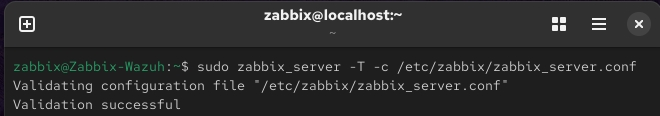

*Применение команды*

При успешной проверке:

```text
# Запускаем Zabbix Server и включаем его автоматический запуск.
sudo systemctl enable --now zabbix-server

# Проверяем состояние: ожидается active.
systemctl is-active zabbix-server

# Проверяем последние сообщения сервера, включая подключение к базе. 
sudo tail -n 30 /var/log/zabbix/zabbix_server.log
```

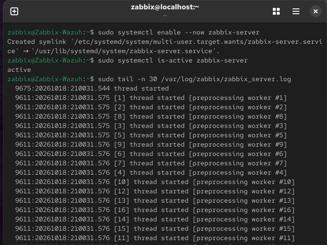

*Применение команды*

### Запуск и проверка агента

```text
# Запускаем агент мониторинга CentOS и включаем автозапуск.
sudo systemctl enable --now zabbix-agent2

# Проверяем состояние: ожидается active. 
systemctl is-active zabbix-agent2
# Проверяем доступность агента: ожидается число 1.
zabbix_get -s 127.0.0.1 -p 10050 -k agent.ping

# Запрашиваем сведения об операционной системе.
zabbix_get -s 127.0.0.1 -p 10050 -k system.uname
```

Эта проверка подтверждает, что агент действительно отвечает на запросы, а не просто числится запущенным. [Документация zabbix_get](https://www.zabbix.com/documentation/7.4/en/manpages/zabbix_get).

### Настройка Nginx

```text
# Открываем установленную конфигурацию сайта Zabbix. 
sudo vim /etc/nginx/conf.d/zabbix.conf
```

В существующем блоке server { ... } найдите директивы listen и server_name. Удалите перед ними #, если они закомментированы, и задайте:

```text
listen 80; 
server_name 192.168.179.20;
```

Меняем только эти две директивы. Они задают порт сайта и адрес, по которому Nginx будет выбирать конфигурацию Zabbix.

Сохраните: Esc → :wq → Enter.

### Часовой пояс PHP

```text
# Открываем настройки отдельного пула PHP-FPM для Zabbix.
sudo vim /etc/php-fpm.d/zabbix.conf 
```

Найдите строку php_value[date.timezone]. Раскомментируйте её, убрав начальный ;, и укажите:

```text
php_value[date.timezone] = Asia/Irkutsk
```

### Доступ веб-интерфейса к базе данных и Zabbix Server

```text
# Разрешаем веб-компоненту подключаться к Zabbix Server.
sudo setsebool -P httpd_can_connect_zabbix on

# Разрешаем веб-компоненту подключаться к PostgreSQL по TCP. 
sudo setsebool -P httpd_can_network_connect_db on
```

Названия начинаются с httpd, но эти параметры SELinux применяются и к нашей связке Nginx/PHP-FPM. [Документация Zabbix](https://www.zabbix.com/documentation/7.4/en/manual/installation/install_from_packages).

#### Проверка конфигураций

```text
# Проверяем синтаксис конфигурации Nginx.
sudo nginx -t

# Проверяем конфигурацию PHP-FPM. 
sudo php-fpm -t
```

#### Запуск служб

```text
# Включаем автоматический запуск обеих служб.
sudo systemctl enable php-fpm nginx

# Запускаем службы с подготовленными настройками.
sudo systemctl restart php-fpm nginx

# Проверяем состояние: ожидается две строки active.
systemctl is-active php-fpm nginx

# Проверяем HTTP-ответ сайта. 
curl -I --connect-timeout 5 http://192.168.179.20/
```

Ожидаемый HTTP-ответ — 200 OK или перенаправление 302 на страницу установки.

## Установка Wazuh на сервер CentOS

Используем официальный установщик для размещения компонентов на одной машине. CentOS Stream 10 поддерживается. [Инструкция Wazuh](https://documentation.wazuh.com/current/quickstart.html).

```text
# Проверяем порты, которые понадобятся компонентам Wazuh.
sudo ss -ltnp \ 
'( sport = :443 or sport = :9200 or sport = :55000 or sport = :1514 or sport = :1515 )'
```

### Подготовка каталога и загрузка установщика

```text
# Создаём отдельный каталог для установщика и создаваемых им файлов.
mkdir -p -m 700 ~/wazuh-install

# Переходим в этот каталог.
cd ~/wazuh-install

# Скачиваем официальный установщик ветки Wazuh 4.14.
# При ошибке загрузки curl сообщит об этом.
curl --fail --show-error --location \
  --output wazuh-install.sh \ 
https://packages.wazuh.com/4.14/wazuh-install.sh
```

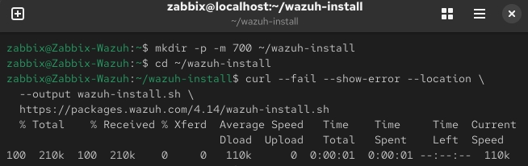

### Запуск установки

```text
# Устанавливаем Manager, Indexer, Dashboard и Filebeat на этой ВМ.
# Параметр -a означает установку всех центральных компонентов. 
sudo bash ./wazuh-install.sh -a
```

Дождитесь завершения и возвращения приглашения терминала. Установщик создаст сертификаты, настроит связи компонентов и выведет:

```text
User: admin
Password: ... 
Installation finished.
```

Сохраните выданный пароль у себя — он понадобится для входа в новый Wazuh Dashboard.

### Проверка служб после установки

```text
# Проверяем все компоненты Wazuh: ожидается четыре строки active.
systemctl is-active \
  wazuh-manager \
  wazuh-indexer \
  wazuh-dashboard \
  filebeat

# Проверяем, что Zabbix и его веб-компоненты продолжают работать.
systemctl is-active \
  zabbix-server \
  zabbix-agent2 \
  postgresql \
  nginx \ 
 php-fpm
```

### Проверка компонентов Wazuh перед настройкой Syslog

```text
# Проверяем Manager, Indexer, Dashboard и Filebeat.
# Ожидается четыре строки active.
systemctl is-active \
  wazuh-manager \
  wazuh-indexer \
  wazuh-dashboard \
  filebeat

# Проверяем порты веб-интерфейса, индексатора, API и подключения агентов.
sudo ss -ltnp \
  '( sport = :443 or sport = :9200 or sport = :55000 or sport = :1514 or sport = :1515 )'

# Уточняем текущий адрес лабораторного интерфейса.
ip -4 -br address ens36
```

### Адрес прослушивания API

```text
# Открываем конфигурацию API Wazuh. 
sudo vim /var/ossec/api/configuration/api.yaml
```

Найдите параметр host. Удалите начальный #, если строка закомментирована, и задайте:

```text
host: ['127.0.0.1']
```

Укажите параметр с начала строки, без отступа. Сохраните файл: Esc → :wq → Enter.

Этот параметр задаёт адрес прослушивания API. [Документация Wazuh](https://documentation.wazuh.com/current/user-manual/api/configuration.html).

### Проверка адреса подключения Dashboard к API

```text
# Показываем только адрес подключения, без паролей из конфигурации.
sudo sed -n '/^[[:space:]]*url:/p' \
  /usr/share/wazuh-dashboard/data/wazuh/config/wazuh.yml
```

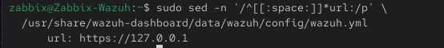

### Применение настройки API

```text
# Перезапускаем Manager — вместе с ним перезапускается API.
sudo systemctl restart wazuh-manager

# Проверяем состояние Manager.
systemctl is-active wazuh-manager

# Проверяем адрес прослушивания API. 
sudo ss -ltnp '( sport = :55000 )'
```

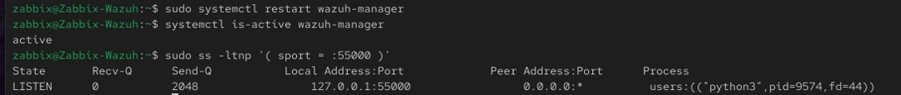

## Приём Syslog от ASA и сохранение JSON-архива

Используем согласованные адреса:

Wazuh: 192.168.179.20.

ASA: 192.168.179.30.

Если адреса изменились, подставьте фактические значения.

### Резервная копия конфигурации

```text
# Сохраняем текущую конфигурацию перед добавлением Syslog-приёмника.
sudo cp -a /var/ossec/etc/ossec.conf \
  /var/ossec/etc/ossec.conf.before-syslog

# Открываем конфигурацию Manager.
sudo vim /var/ossec/etc/ossec.conf
```

### Добавление блока приёма Syslog

Внутри <ossec_config> ... </ossec_config>, рядом с существующим блоком <remote>, добавляем:

```text
<!-- Прямой приём Syslog от Cisco ASA по UDP 514. -->
<remote>
  <connection>syslog</connection>
  <port>514</port>
  <protocol>udp</protocol>
  <allowed-ips>192.168.179.30</allowed-ips>
  <local_ip>192.168.179.20</local_ip> 
</remote>
```

Это дополнительный блок, расположенный на одном уровне с существующим <remote> для агентов на TCP 1514.

Здесь allowed-ips разрешает отправителя ASA, а local_ip задаёт адрес прослушивания Wazuh. [Настройка Syslog-приёмника](https://documentation.wazuh.com/current/user-manual/capabilities/log-data-collection/syslog.html).

### Сохранение всех полученных событий

В этом же файле найдём существующий раздел <global> и параметр logall_json. Изменим его значение:

```text
<logall_json>yes</logall_json>
```

Параметр logall можно оставить:

```text
<logall>no</logall>
```

Так Wazuh будет вести JSON-архив, включая события, для которых не сформировалось оповещение. Настройка распространяется на все источники Manager, поэтому позднее зададим срок хранения. [Архивирование событий Wazuh](https://documentation.wazuh.com/current/user-manual/manager/event-logging.html).

### Проверка конфигурации приёмника

```text
# Проверяем конфигурацию приёмника.
sudo /var/ossec/bin/wazuh-remoted -t

# Проверяем конфигурацию анализатора событий. 
sudo /var/ossec/bin/wazuh-analysisd -t
```

Если обе проверки прошли без ошибок:

```text
# Применяем настройки.
sudo systemctl restart wazuh-manager

# Проверяем состояние службы и UDP-приёмник.
systemctl is-active wazuh-manager
sudo ss -lunp '( sport = :514 )'
```

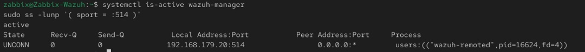

## Изменение IP-адресов в лаборатории

При изменении IP-адресов обновите адресные условия правил firewalld. Номера портов сохраняются, если настройки самих служб не меняются.

В правилах используются два условия:

source address — откуда приходит соединение.

destination address — на какой адрес сервера оно приходит.

Соответствие изменений адресации и правил:

| Что меняется | Что исправить в правилах |
| --- | --- |
| IP ноутбука | source address<br> для TCP 22, 80 и 443 |
| IP сервера Zabbix/Wazuh | destination address<br> во всех правилах, где указан старый IP сервера |
| IP ASA | source address<br> для UDP 514 и UDP 123 |
| IP KSC | source address<br> для TCP 514 |
| IP EVE-NG | source address<br> для UDP 123 |
| Подсеть агентов | source address<br> для TCP 1514, 1515 и 10051 |
| Подсеть лаборатории | Адрес подсети в правиле ICMP |

Это адресные условия rich rules. [Документация firewalld](https://firewalld.org/documentation/man-pages/firewalld.richlanguage.html).

### Пример смены адреса сервера с 192.168.179.20 на 192.168.179.50

Ноутбук сохраняет адрес 192.168.179.1.

### Просмотр существующих правил

```text
# Показываем действующие правила.
sudo firewall-cmd --zone=lab-syslog --list-rich-rules

# Показываем правила, сохранённые для следующих загрузок.
sudo firewall-cmd --permanent --zone=lab-syslog --list-rich-rules
```

### Добавление разрешения для нового адреса

Например, для Wazuh Dashboard:

```text
# Разрешаем ноутбуку подключаться к новому адресу сервера по HTTPS.
sudo firewall-cmd --permanent --zone=lab-syslog \
  --add-rich-rule='rule family="ipv4" source address="192.168.179.1/32" destination address="192.168.179.50/32" port port="443" protocol="tcp" accept'

# Проверяем и применяем сохранённую конфигурацию.
sudo firewall-cmd --check-config
sudo firewall-cmd --reload
```

Аналогично добавляются новые варианты остальных правил со старым destination address.

### Изменение адреса сервера и проверка подключений

Смену IP удобно выполнять через консоль VMware. После изменения проверьте новый SSH-сеанс, веб-интерфейсы и поступление событий.

Если меняются адреса обеих сторон, при поэтапном переносе могут понадобиться временные правила для сочетаний старых и новых адресов.

### Удаление старых правил после проверки

Пример удаления прежнего разрешения HTTPS:

```text
# Удаляем правило, относящееся к старому адресу сервера.
sudo firewall-cmd --permanent --zone=lab-syslog \
  --remove-rich-rule='rule family="ipv4" source address="192.168.179.1/32" destination address="192.168.179.20/32" port port="443" protocol="tcp" accept'

# Применяем изменения.
sudo firewall-cmd --reload
```

Удаляемое правило должно соответствовать записи из --list-rich-rules. Если исходное правило было без destination, используйте именно его полный текст. --permanent сохраняет изменения, а --reload применяет их. [Описание команд](https://firewalld.org/documentation/man-pages/firewall-cmd.html).

Кроме межсетевого экрана потребуется проверить настройки приложений:

| Где | Что изменить |
| --- | --- |
| NetworkManager | IP, маску, при необходимости маршруты |
| VMware VMnet1 | Подсеть и адрес адаптера ноутбука, если меняется вся подсеть |
| Nginx | server_name<br>, где мы указали IP сервера |
| Wazuh <br>/var/ossec/etc/ossec.conf | local_ip<br> при смене IP сервера; <br>allowed-ips<br> при смене адресов отправителей |
| Агенты Zabbix и Wazuh | Адрес сервера подключения |
| ASA и KSC | Адрес получателя Syslog |
| Сертификаты | Адреса SAN, если в сертификате указан изменяемый IP |

Зона lab-syslog останется привязанной к профилю LAB-SYSLOG, если адрес изменяется внутри этого профиля. Локальные подключения компонентов через 127.0.0.1 сохраняются.

## Установка и настройка EVE-NG

### Загрузка установочного ISO

Открываем [официальную страницу загрузки](https://www.eve-ng.net/index.php/download/). Сейчас там доступна EVE-NG BASE/RBL 7.2.0-18, ссылка называется EVE-NG-PRO Full ISO — Direct.

Этот образ поддерживает бесплатный режим Freemium. Его ограничения в семь узлов нам достаточно. Поддержка старой Community Edition завершилась в июне 2026 года. [Сравнение редакций](https://www.eve-ng.net/index.php/features-compare/).

EVE-NG устанавливается из собственного ISO: отдельную CentOS или Ubuntu для неё предварительно устанавливать не нужно.

### Создание виртуальной машины в VMware Workstation

| Параметр | Значение |
| --- | --- |
| Имя ВМ | Lab_EVE-NG |
| Тип ОС | Linux |
| Версия ОС | Ubuntu 64-bit |
| Количество процессоров | 1 |
| Ядер на процессор | 4 |
| Оперативная память | 8192 МБ |
| Новый виртуальный диск | 100 ГБ, SCSI |
| Хранение диска | Один файл, без предварительного выделения всего объёма |

### Включение вложенной виртуализации

До первого запуска откройте VM Settings → Processors и установите:

Virtualize Intel VT-x/EPT or AMD-V/RVI;

Virtualize IOMMU, если этот пункт доступен.

Первая настройка позволяет EVE-NG запускать вложенную виртуальную машину ASA. Включённой виртуализации только в BIOS для этого недостаточно: VMware также должна передать её внутрь EVE-NG. [Требования EVE-NG](https://www.eve-ng.net/index.php/supported-hardware-and-software-systems/).

### Добавление сетевых адаптеров

Добавьте два сетевых адаптера в указанном порядке:

| Адаптер VMware | Подключение | Назначение |
| --- | --- | --- |
| Network Adapter | Custom: <br>VMnet8 — NAT | Интернет для установки и обновлений |
| Network Adapter 2 | Custom: <br>VMnet1 — Host-only | Связь с ноутбуком и сервером Zabbix/Wazuh |

Второй адаптер добавляется через Add → Network Adapter. Для обоих включите Connect at power on.

В EVE-NG первый адаптер соответствует pnet0, второй — pnet1. Позже подключим ASA к Cloud1/pnet1, чтобы она оказалась в одной сети с сервером Wazuh. [Описание подключения внешних ВМ](https://www.eve-ng.net/wp-content/uploads/2025/04/EVE-CE-BOOK-6.3-2024.pdf).

### План адресации

| Устройство | Адрес в лабораторной сети |
| --- | --- |
| Основной ноутбук | 192.168.179.1 |
| EVE-NG | 192.168.179.10<br> — назначим после установки |
| Zabbix/Wazuh | 192.168.179.20 |
| Cisco ASA | 192.168.179.30 |

### Подготовка образа Cisco ASAv

Понадобится исходный файл ASAv 9.13.1 в формате .qcow2. После установки перенесём его в EVE-NG и получим такой путь:

```text
/opt/unetlab/addons/qemu/asav-9.13.1/virtioa.qcow2
```

Префикс каталога asav- и имя диска virtioa.qcow2 нужны, чтобы EVE-NG распознала образ. [Инструкция импорта ASAv](https://www.eve-ng.net/index.php/documentation/howtos/howto-add-cisco-asav/).

### Установка EVE-NG

Стандартные данные входа в систему после установки:

```text
login: root
password: eve
```

### Параметры первоначальной настройки EVE-NG

| Экран | Что указать | Зачем |
| --- | --- | --- |
| Ввод\Повтор пароля | Тот же пароль <br>root | Подтверждение пароля |
| Hostname | eve-ng | Имя виртуальной машины |
| DNS domain name | lab.test | Локальное доменное имя лаборатории |
| DHCP / Static | DHCP | Первый адаптер получит адрес от VMware NAT |
| NTP server | pool.ntp.org | Синхронизация времени |
| Proxy Server | direct connection | Прямое подключение к интернету |

Адрес 192.168.179.10 здесь пока не вводи: мастер настраивает первый адаптер, подключённый к VMnet8. Постоянный адрес лаборатории назначим второму адаптеру. [Первоначальная настройка EVE-NG](https://www.eve-ng.net/index.php/documentation/installation/howto-configure-eve-during-first-boot/).

Обновите сведения о репозиториях и операционную систему.

### Подключение к веб-интерфейсу

В адресной строке браузера укажите https:// и фактический адрес EVE-NG, полученный на предыдущем шаге.

Стандартные данные первого входа:

| Поле | Значение |
| --- | --- |
| Username | admin |
| Password | eve |
| Console | HTML5 console<br>, если доступен выбор |

Пароль root, заданный в мастере, относится к Linux. Стандартный вход в веб-интерфейс — отдельная учётная запись. [Справка EVE-NG](https://www.eve-ng.net/index.php/faq/).

## Настройка адреса EVE-NG и перенос образа ASAv

### Просмотр текущей конфигурации сети

```text
# Показываем интерфейсы и адреса.
ip -br address

# Показываем сохранённую конфигурацию сети. 
cat /etc/network/interfaces
```

### Резервная копия и редактирование настроек сети

```text
# Сохраняем исходные настройки перед изменением.
cp -a /etc/network/interfaces /etc/network/interfaces.before-lab

# Открываем настройки сети. 
nano /etc/network/interfaces
```

Находим существующий блок pnet1. Замените в нём inet manual на inet static и добавьте адрес с маской. Получится примерно так:

```text
iface eth1 inet manual

auto pnet1
iface pnet1 inet static
    address 192.168.179.10
    netmask 255.255.255.0
    bridge_ports eth1 
    bridge_stp off
```

Редактируем существующий блок, чтобы не получить два определения pnet1

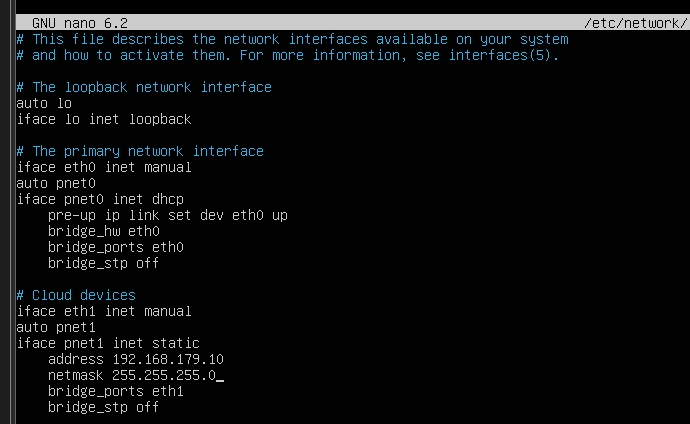

### Применение настроек перезагрузкой EVE-NG

```text
# Перезагружаем EVE-NG для проверки сохранённых настроек. 
reboot
```

### Создание каталога ASAv

```text
# Создаём каталог образа ASAv версии 9.13.1. 
mkdir -p /opt/unetlab/addons/qemu/asav-9.13.1
```

### Перенос образа через WinSCP

Параметры подключения с хоста:

| Поле | Значение |
| --- | --- |
| Протокол | SFTP |
| Сервер | 192.168.179.10 |
| Порт | 22 |
| Пользователь | root |
| Пароль | Заданный при первоначальной настройке EVE-NG |

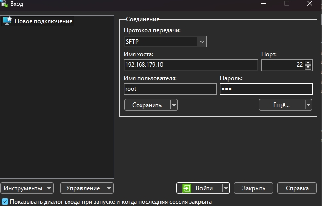

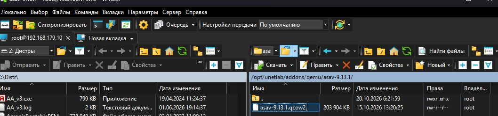

Перемещаем туда исходный файл ASAv 9.13.1 .qcow2. Дождитесь окончания копирования, затем переименуйте загруженный файл в:

```text
virtioa.qcow2
```

Итоговый путь:

```text
/opt/unetlab/addons/qemu/asav-9.13.1/virtioa.qcow2
```

Такое имя каталога и диска требуется шаблону ASAv в EVE-NG. [Официальная инструкция импорта](https://www.eve-ng.net/index.php/documentation/howtos/howto-add-cisco-asav/).

### Настройка прав на загруженный образ

```text
# Устанавливаем права, необходимые EVE-NG для работы с образом.
/opt/unetlab/wrappers/unl_wrapper -a fixpermissions

# Проверяем наличие и размер загруженного файла. 
ls -lh /opt/unetlab/addons/qemu/asav-9.13.1/virtioa.qcow2
```

Следующим этапом создадим лабораторию, добавим ASAv и подключим её к Cloud1/pnet1 для связи с Wazuh.

### Подготовка последовательной консоли ASAv 9.13.1

Для старых образов ASAv может потребоваться включение последовательной консоли. Выполните подготовку до создания и запуска узла.

В терминале EVE-NG под root:

```text
# Сохраняем исходный образ перед изменением.
cp --sparse=always \
  /opt/unetlab/addons/qemu/asav-9.13.1/virtioa.qcow2 \
  /root/asav-9.13.1-before-serial.qcow2

# Обновляем список пакетов и устанавливаем средство работы с образом.
apt update
apt install -y libguestfs-tools

# Открываем диск ASAv для изменения. 
guestfish --rw -a /opt/unetlab/addons/qemu/asav-9.13.1/virtioa.qcow2
```

Появляется приглашение guestfish. В нём выполняем:

```text
run 
list-filesystems
mount /dev/sda2 /
touch /use_ttyS0
umount /
exit
```

Файл /use_ttyS0 включает вывод консоли через последовательный порт. Если /dev/sda2 отсутствует или монтирование завершилось ошибкой, разметку потребуется проверить по выводу команды. [Инструкция EVE-NG для ASAv](https://www.eve-ng.net/index.php/documentation/howtos/howto-add-cisco-asav/).

После выхода из guestfish:

```text
# Устанавливаем права на файлы образов.
/opt/unetlab/wrappers/unl_wrapper -a fixpermissions
```

## Создание лаборатории в EVE-NG

| Поле | Значение |
| --- | --- |
| Name | Cisco-ASA-Wazuh-Lab |
| Description | Сбор событий Cisco ASAv в Wazuh |
| Остальные параметры | Оставьте стандартными |

### Добавление Cisco ASAv

На свободном месте схемы нажмите правой кнопкой → Node. Выберите шаблон Cisco ASAv.

| Параметр | Значение |
| --- | --- |
| Image | Образ с обозначением <br>9.13.1 |
| Name / Prefix | ASAv-LAB |
| Number of nodes | 1 |
| CPU | 1 |
| RAM | 2048<br> МБ |
| Ethernets | 4 |
| Console | telnet |
| Остальные настройки QEMU | Значения шаблона |

HTML5 console при входе в EVE-NG и telnet в настройках узла совместимы: EVE предоставляет доступ к Telnet-консоли через браузер.

Если образ отсутствует в списке, проверьте его каталог, имя virtioa.qcow2 и выполнение fixpermissions.

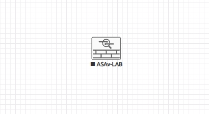

### Подключение к лабораторной сети

На свободном месте нажмите правой кнопкой → Network.

Укажите:

| Поле | Значение |
| --- | --- |
| Name / Prefix | LAB-SYSLOG |
| Type | Cloud1<br>, соответствующий <br>pnet1 |

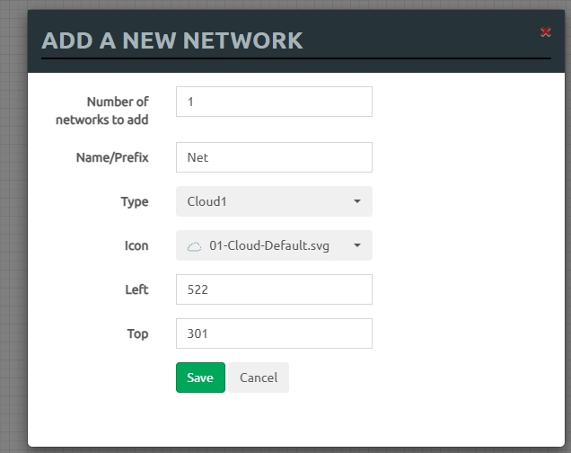

Соедините эту сеть с интерфейсом GigabitEthernet0/1 узла ASAv.

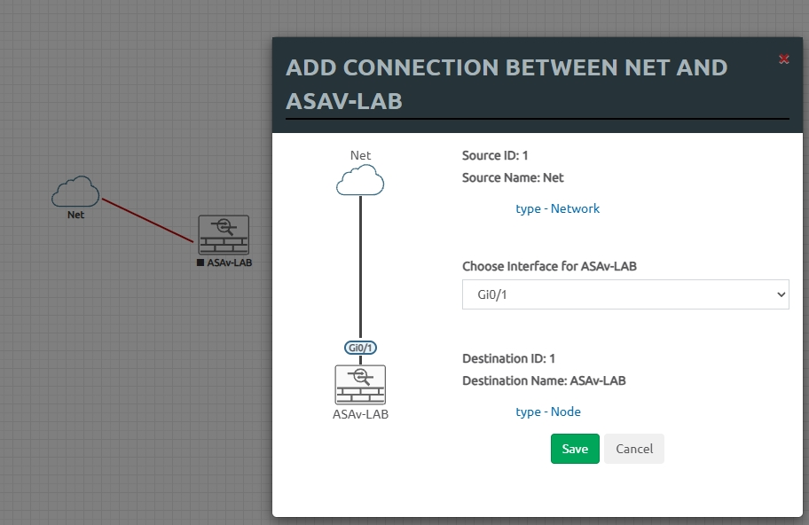

Получится такой путь:

```text
ASAv: GigabitEthernet0/1
             │
      Cloud1 / pnet1
             │
 Второй адаптер EVE-NG
             │
     VMware VMnet1
             │
   Wazuh: 192.168.179.20
```

Cloud1 связывает узел внутри EVE-NG со вторым сетевым адаптером её ВМ. [Подключение внешних виртуальных машин](https://www.eve-ng.net/wp-content/uploads/2025/04/EVE-CE-BOOK-6.3-2024.pdf).

### Запуск ASA и открытие консоли

Для работы консоли при входе в EVE-NG необходимо выбрать HTML5 console вместо Native console.

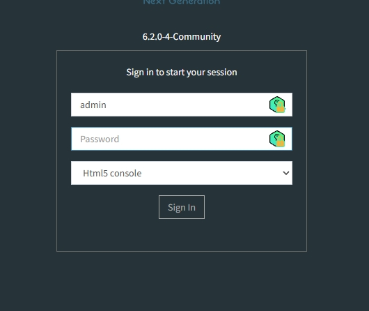

Правой кнопкой по ASAv → Start, затем двойной щелчок по узлу.

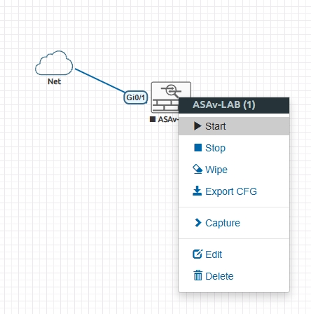

Первый запуск может занять несколько минут. Дождитесь приглашения:

```text
ciscoasa>
```

Если появится предложение интерактивной первоначальной настройки, ответьте no: параметры зададим командами.

Введите:

```text
enable
```

На чистом образе пароль enable может быть пустым — тогда нажмите Enter. Если появится запрос создания нового пароля, задайте его и сохраните у себя.

## Настройка лабораторного интерфейса ASA

Выполните следующие команды в консоли ASA с приглашением, оканчивающимся на #. Строки с ! содержат пояснения.

```text
! Переходим в режим настройки устройства.
configure terminal

! Задаём имя ASA, которое будет отображаться в приглашении консоли.
hostname ASAv-LAB

! Выбираем интерфейс, подключённый к Cloud1 и сети VMware VMnet1.
interface GigabitEthernet0/1

! Добавляем описание назначения интерфейса.
 description SYSLOG_TO_WAZUH

! Назначаем логическое имя интерфейса.
! Имя LOGS затем используем в настройках отправки Syslog.
 nameif LOGS

! Устанавливаем уровень доверия интерфейсу: 100 — максимальный.
! Это само по себе не означает разрешение любого трафика.
 security-level 100

! Назначаем адрес ASA в лабораторной сети 192.168.179.0/24.
! Сервер Wazuh находится в этой же сети по адресу 192.168.179.20.
 ip address 192.168.179.30 255.255.255.0

! Включаем интерфейс, снимая административное отключение.
 no shutdown

! Выходим из настройки интерфейса в общий режим конфигурации.
exit

! Разрешаем устройствам лабораторной сети проверять ASA через ping.
! Правило относится к самой ASA, а не к проходящему через неё трафику.
icmp permit 192.168.179.0 255.255.255.0 LOGS

! Завершаем настройку и возвращаемся в привилегированный режим.
end

! Сохраняем конфигурацию, чтобы она осталась после перезагрузки.
write memory
```

Проверьте настройки:

```text
! Показываем IP-адреса и состояние интерфейсов.
show interface ip brief

! Проверяем назначенные логические имена интерфейсов.
show nameif

! Проверяем доступность Wazuh через интерфейс LOGS. 
ping LOGS 192.168.179.20
```

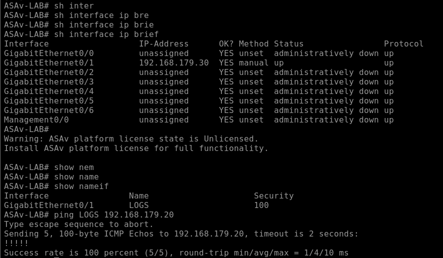

## Отправка Syslog и проверка доставки событий

```text
! Переходим в режим настройки.
configure terminal

! Включаем журналирование.
logging enable

! Добавляем метки времени в формате RFC 5424.
logging timestamp rfc5424

! Включаем Device ID: используем текущее имя устройства ASAv-LAB.
logging device-id hostname

! Сохраняем события уровней 0–7 в локальном буфере ASA.
logging buffered debugging

! Выбираем уровни 0–7 для отправки на сервер Syslog.
logging trap debugging

! Отправляем события через LOGS на Wazuh по UDP 514.
logging host LOGS 192.168.179.20 udp/514

! Завершаем настройку.
end

! Сохраняем конфигурацию.
write memory

! Проверяем настройки, включая Device ID.
show logging
```

Порог debugging включает уровни 0–7 для разрешённых сообщений Syslog. [Справочник команд Cisco](https://www.cisco.com/c/en/us/td/docs/security/asa/asa-cli-reference/I-R/asa-command-ref-I-R/m_log-lz.html).

### Проверка поступления пакетов на CentOS

```text
# Показываем пять пакетов Syslog от ASA вместе с текстом сообщений.
sudo tcpdump -ni ens36 -c 5 -A \ 
 'src host 192.168.179.30 and dst host 192.168.179.20 and udp dst port 514'
```

Оставьте команду работать и переключитесь в консоль ASA:

```text
! Сохранение конфигурации создаёт настоящее событие для проверки.
write memory
```

Для этого действия ASA формирует сообщение о сохранении конфигурации, обычно с идентификатором 111004. [Описание события Cisco](https://www.cisco.com/c/en/us/td/docs/security/asa/syslog/asa-syslog/syslog-messages-101001-to-199021.html).

В выводе tcpdump должны появиться пакеты от .30 к .20:514 и текст с %ASA-. Остановить ожидание можно через Ctrl+C.

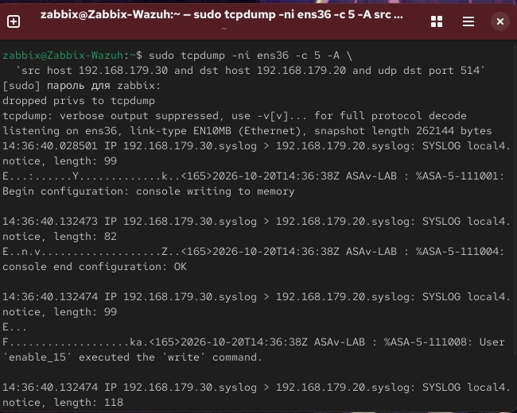

### Проверка записи событий в Wazuh

```text
# Показываем последние пять записей, содержащих адрес ASA.
sudo grep -F '192.168.
179.30' \  /var/ossec/logs/archives/archives.json | tail -n 5
```

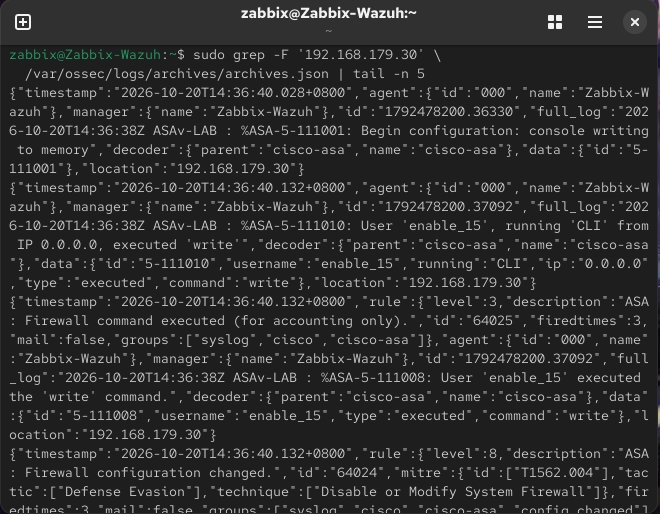

## Отображение событий ASA в Wazuh Dashboard

Переходите к этому этапу, если сообщения ASA уже появились в /var/ossec/logs/archives/archives.json.

Последовательность передачи данных:

ASA → Wazuh Manager → archives.json → Filebeat → Wazuh Indexer → Dashboard

Filebeat здесь читает JSON-архив менеджера и передаёт записи индексатору.

### Настройка Filebeat на CentOS

```text
# Сохраняем конфигурацию перед изменением.
sudo cp -a /etc/filebeat/filebeat.yml \
  /etc/filebeat/filebeat.yml.before-archives

# Открываем конфигурацию. 
sudo vim /etc/filebeat/filebeat.yml
```

Найдём существующий блок filebeat.modules. Для archives установим enabled: true, чтобы получилось:

```text
filebeat.modules:
  - module: wazuh
    # Продолжаем отправлять оповещения, сформированные правилами Wazuh.
    alerts:
      enabled: true

    # Дополнительно отправляем все события из JSON-архива менеджера.
    archives:
      enabled: true
```

Это фрагмент внутри существующего файла. Параметры подключения, сертификатов и остальные настройки сохраняются.

В Vim: i → внесите изменение → Esc → :wq → Enter.

Такое включение архива предусмотрено [документацией Wazuh](https://documentation.wazuh.com/current/user-manual/manager/event-logging.html).

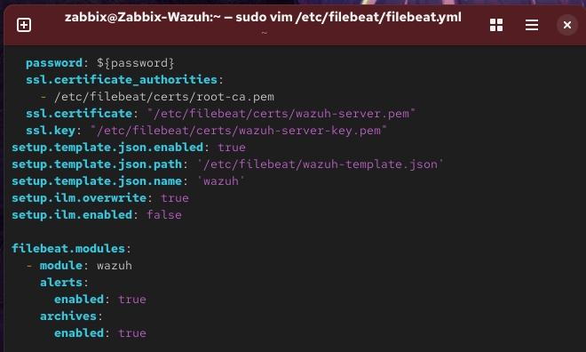

### Проверка конфигурации и подключения к индексатору

```text
# Проверяем корректность конфигурации Filebeat.
# Явно указываем каталоги установленной службы, включая хранилище секретов.
sudo /usr/share/filebeat/bin/filebeat test config \
  -c /etc/filebeat/filebeat.yml \
  --path.home /usr/share/filebeat \
  --path.config /etc/filebeat \
  --path.data /var/lib/filebeat \ 
 --path.logs /var/log/filebeat
```

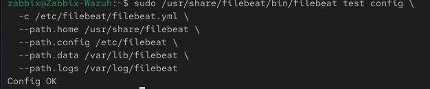

Затем:

```text
# Проверяем соединение, сертификат и авторизацию в Wazuh Indexer.
sudo /usr/share/filebeat/bin/filebeat test output \
  -c /etc/filebeat/filebeat.yml \
  --path.home /usr/share/filebeat \
  --path.config /etc/filebeat \
  --path.data /var/lib/filebeat \ 
 --path.logs /var/log/filebeat
```

Проверки соединения и TLS должны завершиться успешно. При ошибке сначала исправляем её, затем продолжаем. [Назначение проверочных команд Filebeat](https://www.elastic.co/guide/en/beats/filebeat/7.17/command-line-options.html).

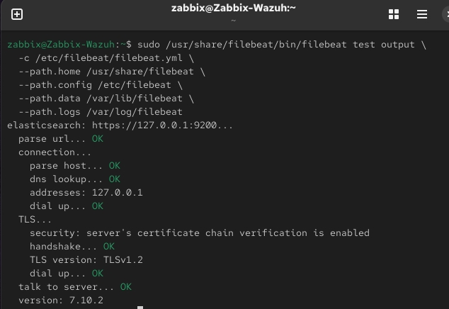

### Применение настройки Filebeat

```text
# Перезапускаем Filebeat с включённой отправкой архива.
sudo systemctl restart filebeat

# Проверяем состояние службы. 
systemctl is-active filebeat
```

### Проверка индекса через Dashboard

Откройте Wazuh Dashboard, затем меню ☰ → Indexer management → Dev Tools.

Выполните запрос:

```text
GET /_cat/indices/wazuh-archives-*?v
```

Должен появиться индекс с именем, начинающимся на wazuh-archives-, и документами внутри.

Если индекса нет, на CentOS просмотрите сообщения службы:

```text
# Показываем последние сообщения Filebeat для поиска причины. 
sudo journalctl -u filebeat -n 50 --no-pager
```

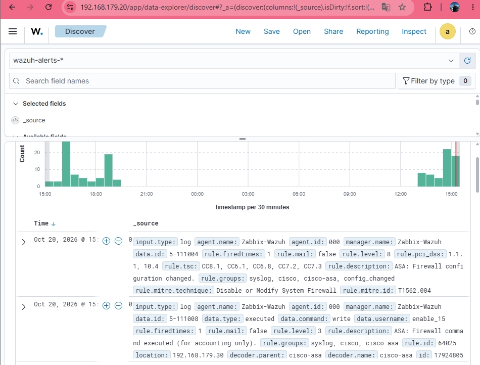

### Создание шаблона индексов для архива

В меню Dashboard откройте:

Dashboard management → Dashboard Management → Index patterns → Create index pattern.

Укажем:

| Параметр | Значение |
| --- | --- |
| Index pattern name | wazuh-archives-* |
| Time field | timestamp |

Выбирайте именно timestamp, без символа @. Если такой шаблон уже существует, используйте его. [Настройка шаблона архива](https://documentation.wazuh.com/current/user-manual/wazuh-indexer/wazuh-indexer-indices.html).

### Просмотр событий Cisco ASA

Перейдите в ☰ → Explore → Discover:

Выберите шаблон wazuh-archives-*;

установите период Last 24 hours;

введите фильтр:

```text
location: "192.168.179.30"
```

Нажмите Refresh / Update. Под графиком должны появиться строки событий ASA. Именно этот раздел используется для просмотра архивных событий Wazuh. [Документация Wazuh](https://documentation.wazuh.com/current/user-manual/manager/event-logging.html).

Добавьте в таблицу доступные поля:

| Поле | Назначение |
| --- | --- |
| timestamp | Время события |
| location | Источник Syslog |
| decoder.name | Декодер, распознавший сообщение |
| full_log | Полный текст события ASA |

Сохраните поиск кнопкой Save под именем Cisco ASA — все события.

## Создание дашборда событий ASA

Создайте дашборд с двумя первыми панелями: числом событий и журналом ASA.

### Открытие редактора визуализаций

Нажмите ☰ → Explore → Visualize → Create new visualization. Выберите тип Metric, затем источник:

```text
wazuh-archives-*
```

### Настройка счётчика событий ASA

В строке поиска в верхней части страницы введите:

```text
location: "192.168.179.30"
```

Справа сверху выберите Last 24 hours.

В панели настройки откройте Metrics → Metric и задайте:

| Параметр | Значение |
| --- | --- |
| Aggregation | Count |
| Custom label, если доступно | События ASA |

Для Count выбирать поле не требуется: он считает записи, соответствующие фильтру.

Нажмите Update или кнопку применения изменений. В области просмотра появится число индексированных событий ASA за выбранный период.

### Сохранение визуализации

Вверху нажмите Save и укажите название:

```text
Cisco ASA — количество событий
```

Подтвердите сохранение. Создание отдельных визуализаций через Visualize описано в [руководстве Wazuh](https://documentation.wazuh.com/current/user-manual/wazuh-dashboard/creating-custom-dashboards.html).

### Создание дашборда

Откройте:

☰ → Explore → Dashboards → Create new dashboard.

Нажмите Add an existing — в некоторых версиях кнопка называется Add.

В списке по очереди выберите:

```text
Cisco ASA — количество событий 
Cisco ASA — все события
```

Первая панель покажет счётчик, вторая — сохранённую таблицу Discover. Сохранённые поиски можно добавлять на дашборд вместе с визуализациями. [Руководство OpenSearch](https://docs.opensearch.org/2.19/dashboards/dashboard/index/).

### Размещение панелей и сохранение дашборда

Перетащите счётчик наверх, а таблицу событий разместите под ним. Потяните за нижний правый угол таблицы, чтобы увеличить её ширину и высоту.

Установите общий период Last 24 hours. В строке поиска дашборда также укажите:

```text
location: "192.168.179.30"
```

Нажмите Save и назовите дашборд:

```text
Cisco ASA — мониторинг и безопасность
```

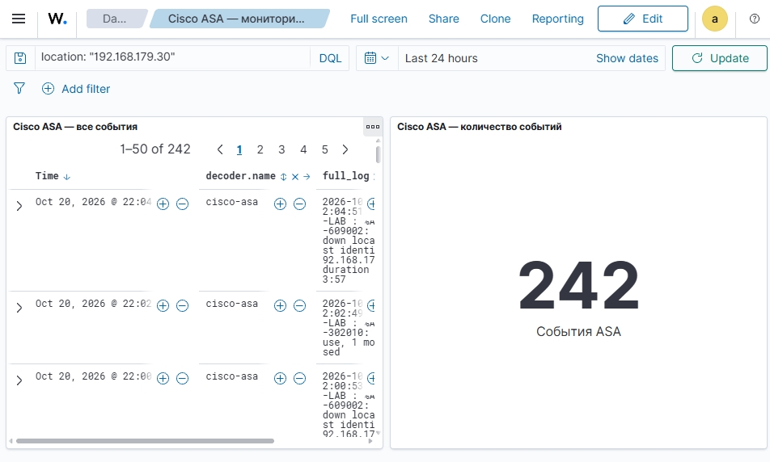

## График событий и диаграмма сообщений

Добавим две панели: события по времени и наиболее частые сообщения ASA. Обе будут использовать архив wazuh-archives-*.

### Создание графика событий по времени

Откройте ☰ → Explore → Visualize → Create new visualization. Выберите Line, затем:

```text
wazuh-archives-*
```

В строке поиска сверху введите:

```text
location: "192.168.179.30"
```

Установите период Last 24 hours и нажмите Refresh / Update.

#### Вертикальная ось с количеством событий

В панели настроек откройте Data → Metrics → Y-axis.

| Параметр | Значение |
| --- | --- |
| Aggregation | Count |
| Custom label | Количество событий |

Count считает записи ASA в каждом временном интервале. Поле для него выбирать не требуется.

#### Горизонтальная ось времени

В разделе Buckets нажмите Add → X-axis.

| Параметр | Значение |
| --- | --- |
| Aggregation | Date Histogram |
| Field | timestamp |
| Interval / Minimum interval | Оставьте автоматический вариант, если он выбран |
| Custom label | Время |

Нажмите Update. График покажет, когда поступали события и как менялось их количество. Это количество записей за интервал, а не скорость трафика через ASA. [Пример настройки графика OpenSearch](https://docs.opensearch.org/latest/dashboards/getting-started/explore-visualize/).

Нажмите Save и сохраните под именем:

```text
Cisco ASA — события по времени
```

### Диаграмма наиболее частых сообщений

Снова откройте Visualize → Create new visualization.

Выберите Pie, затем wazuh-archives-*. Установите тот же период и фильтр:

```text
location: "192.168.179.30"
```

В разделе Metrics → Slice size укажите:

| Параметр | Значение |
| --- | --- |
| Aggregation | Count |
| Custom label | Количество сообщений |

Затем нажмите Buckets → Add → Split slices.

| Параметр | Значение |
| --- | --- |
| Aggregation | Terms |
| Field | data.id |
| Order by | Metric: Count |
| Order | Descending |
| Size | 10 |
| Custom label | Код сообщения ASA |

Terms создаст отдельный сектор для каждого значения [data.id](http://data.id/). В полученных данных это значения наподобие 7-609002 — уровень Syslog вместе с кодом сообщения.

#### Настройка и сохранение диаграммы

Если в настройках Terms доступен пункт Group other values in separate bucket, включите его. Тогда сообщения за пределами первой десятки попадут в сектор Other.

Во вкладке Options можно включить Donut, чтобы получить кольцевую диаграмму.

Нажмите Update, затем Save. Название:

```text
Cisco ASA — наиболее частые сообщения
```

Размер сектора будет показывать число сообщений данного типа. Эта диаграмма помогает определить, какие события преобладают в журнале. [Настройки круговой диаграммы OpenSearch](https://docs.opensearch.org/latest/dashboards/visualize/visualize-app/pie-charts/).

### Добавление визуализаций на дашборд

Откройте ☰ → Explore → Dashboards, затем:

```text
Cisco ASA — мониторинг и безопасность
```

Нажмите Edit → Add an existing / Add и выберите:

```text
Cisco ASA — события по времени
Cisco ASA — наиболее частые сообщения
```

Закройте список добавления панелей. Разместите их так:

| Область | Панели |
| --- | --- |
| Верхняя часть | Счётчик событий и кольцевая диаграмма |
| Середина | График событий по времени |
| Нижняя часть | Таблица <br>Cisco ASA — все события |

Размер меняется перетягиванием нижнего правого угла панели. Нажмите Save, чтобы сохранить расположение. [Добавление визуализаций на дашборд Wazuh](https://documentation.wazuh.com/current/user-manual/wazuh-dashboard/creating-custom-dashboards.html).

## Проверка разрешённого и заблокированного трафика

Теперь создадим два тестовых узла по разные стороны ASA. Проверим разрешённый ping и заблокированное подключение к TCP-порту 22 — эти события станут основой следующих панелей.

Схема лаборатории:

### Добавление двух узлов VPCS в EVE-NG

В консоли ASA сначала сохраните конфигурацию:

```text
! Сохраняем действующие настройки перед подключением новых узлов.
write memory
```

В EVE-NG остановите ASAv через правую кнопку → Stop.

Затем на свободном месте схемы выберите правую кнопку → Node → Virtual PC / VPCS. Создайте два узла:

PC-IN — компьютер внутренней сети;

PC-OUT — компьютер второй тестовой сети.

Соедините:

| Узел | Интерфейс узла | Интерфейс ASA |
| --- | --- | --- |
| PC-IN | eth0 | GigabitEthernet0/0 |
| PC-OUT | eth0 | GigabitEthernet0/2 |
| Существующий Cloud1 | — | GigabitEthernet0/1 |

Для двух новых соединений используйте прямые линии между узлами. Затем запустите ASAv и оба VPCS.

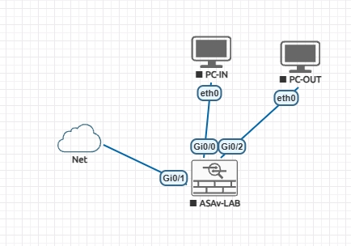

### Назначение адресов новым интерфейсам ASA

Откройте консоль ASAv-LAB, выполните enable, затем:

```text
! Переходим в режим настройки.
configure terminal

! Настраиваем интерфейс внутренней тестовой сети.
interface GigabitEthernet0/0
 description TEST_NETWORK_INSIDE
 nameif INSIDE
 security-level 100
 ip address 172.31.50.1 255.255.255.0
 no shutdown
exit

! Настраиваем интерфейс второй тестовой сети.
interface GigabitEthernet0/2
 description TEST_NETWORK_OUTSIDE
 nameif OUTSIDE
 security-level 0
 ip address 172.31.60.1 255.255.255.0
 no shutdown
exit

! Разрешаем каждому тестовому компьютеру проверять свой шлюз через ping.
! Эти команды относятся к адресам самой ASA.
icmp permit host 172.31.50.10 INSIDE
icmp permit host 172.31.60.10 OUTSIDE

end

! Сохраняем адреса и состояние интерфейсов.
write memory
```

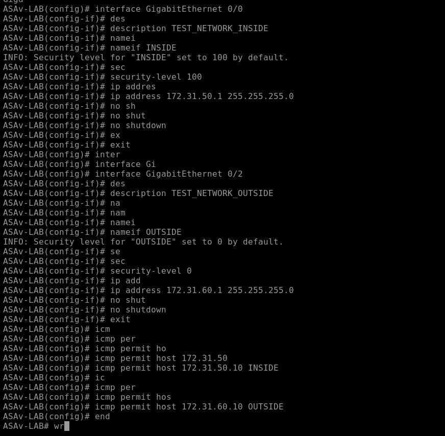

### Настройка адресов тестовых компьютеров

Откройте консоль PC-IN и выполните:

```text
ip 172.31.50.10/24 172.31.50.1
save
ping 172.31.50.1
```

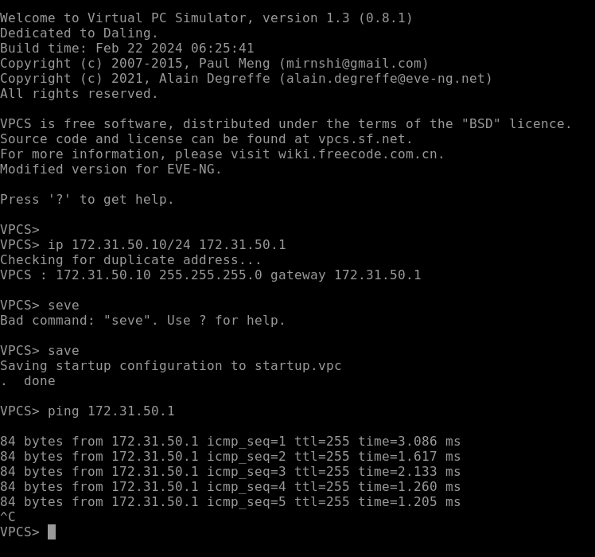

Затем в консоли PC-OUT:

```text
ip 172.31.60.10/24 172.31.60.1
save
ping 172.31.60.1
```

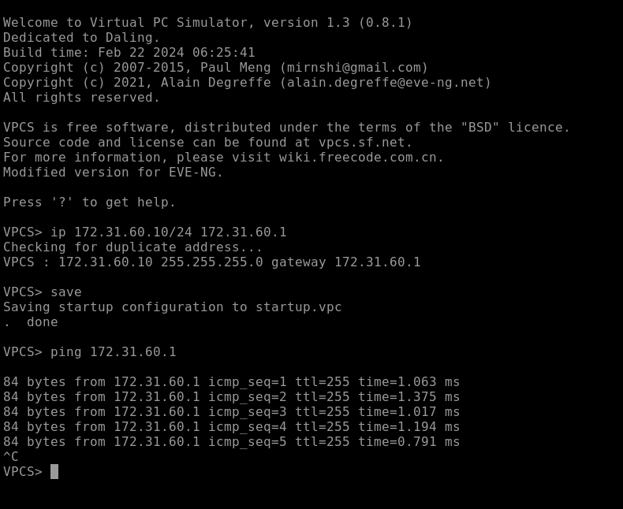

Команда ip назначает адрес, маску и шлюз. save сохраняет настройки VPCS. Каждый компьютер должен получить ответы от своего шлюза. [Справочник VPCS](https://github.com/GNS3/vpcs/blob/master/man/vpcs.1).

### Правила прохождения трафика через ASA

В консоли ASAv-LAB:

```text
configure terminal

! Запрещаем PC-IN обращаться к TCP-порту 22 компьютера PC-OUT.
! Для явного запрета сохраняем стандартное журналирование ASA.
access-list LAB_INSIDE_IN extended deny tcp host 172.31.50.10 host 172.31.60.10 eq 22

! Разрешаем запросы ping между тестовыми компьютерами.
! Дополнительно журналируем срабатывания разрешающего правила.
access-list LAB_INSIDE_IN extended permit icmp host 172.31.50.10 host 172.31.60.10 echo log informational interval 1

! Явно запрещаем остальной входящий трафик этой тестовой сети.
access-list LAB_INSIDE_IN extended deny ip any any

! Применяем созданный список правил на входе интерфейса INSIDE.
access-group LAB_INSIDE_IN in interface INSIDE

! Разрешаем ответы PC-OUT на запросы ping от PC-IN.
access-list LAB_OUTSIDE_IN extended permit icmp host 172.31.60.10 host 172.31.50.10 echo-reply log informational interval 1

! Явно запрещаем прочий входящий трафик со стороны OUTSIDE.
access-list LAB_OUTSIDE_IN extended deny ip any any

! Применяем правила на входе интерфейса OUTSIDE.
access-group LAB_OUTSIDE_IN in interface OUTSIDE

end

! Сохраняем правила. 
write memory
```

Ответы ICMP разрешены отдельным правилом: в этой схеме мы явно разрешаем запрос и ответ на двух интерфейсах. [Обработка обратного трафика ASA](https://www.cisco.com/c/en/us/td/docs/security/asa/asa912/configuration/firewall/asa-912-firewall-config/access-rules.html).

### Проверка разрешённого трафика

В консоли PC-IN:

```text
ping 172.31.60.10 -c 5
```

Ожидаем ответы от PC-OUT. Теперь пакет проходит через ASA между двумя сетями.

Если ответов нет, сначала проверьте на ASA:

```text
! Проверяем адреса и состояние интерфейсов.
show interface ip brief

! Проверяем срабатывания разрешающих и запрещающих правил.
show access-list LAB_INSIDE_IN
show access-list LAB_OUTSIDE_IN
```

### Проверка блокировки TCP-порта 22

В консоли PC-IN:

```text
ping 172.31.60.10 -P 6 -p 22 -f S -c 5
```

Здесь:

| Параметр | Назначение |
| --- | --- |
| -P 6 | Использовать TCP |
| -p 22 | Направить пакеты на порт 22 |
| -f S | Установить флаг SYN |
| -c 5 | Отправить пять проб |

Ожидаем отсутствие успешного подключения. На ASA выполните:

```text
! Проверяем увеличение hitcnt у правила запрета TCP-порта 22.
show access-list LAB_INSIDE_IN

! Ищем сообщения о блокировках в локальном журнале.
show logging | include 106023
```

Увеличение hitcnt подтверждает, что пакеты попали под нужное правило. Для явных запретов со стандартным журналированием ASA использует сообщение 106023. [Журналирование правил ASA](https://www.cisco.com/c/en/us/td/docs/security/asa/asa912/configuration/firewall/asa-912-firewall-config/access-rules.html).

### Просмотр результатов проверки в Wazuh

Откройте Discover → wazuh-archives-*, выберите Last 15 minutes и введите:

```text
location: "192.168.179.30" AND (data.id: "4-106023" OR data.id: "6-106100")
```

Нажмите Refresh.

Ожидаем сообщения двух типов:

| Код | Что проверяем |
| --- | --- |
| 4-106023 | Блокировку TCP-подключения |
| 6-106100 | Журналирование разрешённого ICMP-трафика |

Раскройте запись 4-106023. При успешном разборе должны появиться поля:

```text
data.action: Deny
data.protocol: tcp
data.srcip: 172.31.50.10
data.dstip: 172.31.60.10 
data.dstport: 22
```

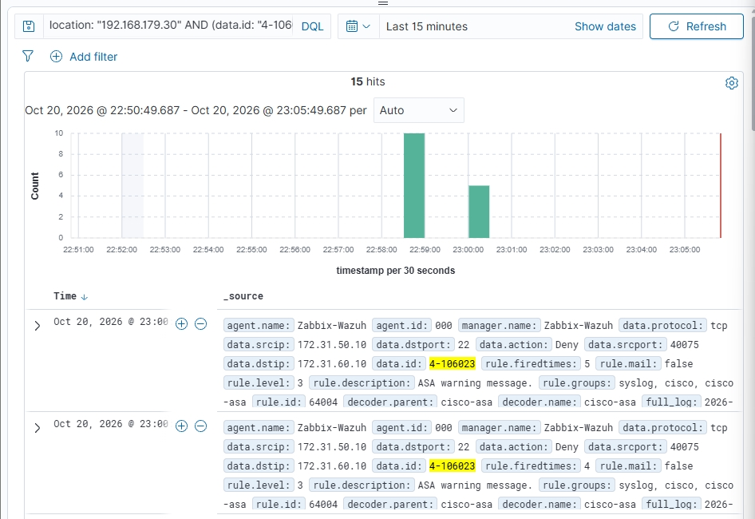

## Панели блокировок по ACL

Теперь добавим три счётчика и три диаграммы блокировок по ACL.

### Общий источник и фильтр для панелей блокировок

Каждую визуализацию создавайте через:

☰ → Explore → Visualize → Create new visualization.

Источник:

```text
wazuh-archives-*
```

Фильтр в строке поиска:

```text
location: "192.168.179.30&quot; AND data.id: "4-106023"
```

Период — Last 24 hours. Этот фильтр выбирает сообщения ASA о блокировках по ACL.

### Создание трёх числовых счётчиков

Выбирайте тип Metric. В разделе Data → Metrics → Metric задавайте параметры из таблицы.

Каждая строка — отдельная визуализация:

| Название при сохранении | Aggregation | Field |
| --- | --- | --- |
| Cisco ASA — сообщения о блокировках ACL | Count | Не требуется |
| Cisco ASA — число источников блокируемого трафика | Unique Count | data.srcip |
| Cisco ASA — число портов назначения в блокировках | Unique Count | data.dstport |

Для каждой панели нажимайте Update → Save.

Count считает записи, а Unique Count — различные значения поля. Например, повторные обращения одного компьютера увеличат число сообщений, но источник останется один. [Описание агрегаций OpenSearch](https://docs.opensearch.org/latest/dashboards/visualize/visualize-app/configuring-viz/).

### Диаграммы источников и назначений блокируемого трафика

Выберите Vertical Bar и используйте общий источник и фильтр для панелей блокировок, указанные выше.

В разделе Metrics → Y-axis:

| Параметр | Значение |
| --- | --- |
| Aggregation | Count |
| Custom label | Сообщения о блокировках |

Затем Buckets → Add → X-axis:

| Параметр | Значение |
| --- | --- |
| Aggregation | Terms |
| Field | data.srcip |
| Order by | Metric: Count |
| Order | Descending |
| Size | 10 |

Нажмите Update → Save. Название:

```text
Cisco ASA — источники блокируемого трафика
```

Каждый столбец покажет число выбранных сообщений для одного IP-адреса. [Настройка столбчатых диаграмм](https://docs.opensearch.org/latest/dashboards/visualize/visualize-app/bar-charts/).

| Название при сохранении | Поле в Buckets → X-axis |
| --- | --- |
| Cisco ASA — адреса назначения в блокировках | data.dstip |
| Cisco ASA — порты назначения в блокировках | data.dstport |

Сейчас ожидаем один адрес назначения 172.31.60.10 и один порт 22. По мере новых проверок появятся дополнительные столбцы.

Если нужного поля нет в выпадающем списке, откройте Dashboard management → Dashboard Management → Index patterns → wazuh-archives-* и обновите список полей кнопкой Refresh field list, затем вернитесь к визуализации.

### Добавление шести панелей на дашборд

Откройте:

```text
Cisco ASA — мониторинг и безопасность
```

Нажмите Edit → Add an existing / Add и выберите созданные визуализации.

Разместите:

три новых счётчика рядом;

диаграммы источников, назначений и портов — под ними;

таблицу событий — ниже.

Общий фильтр дашборда оставьте таким:

```text
location: "192.168.179.30"
```

Условие data.id: "4-106023" сохраняется внутри новых визуализаций. Так общий график продолжит показывать все события ASA, а панели блокировок — свою выборку.

Нажмите Save. [Добавление панелей в Wazuh](https://documentation.wazuh.com/current/user-manual/wazuh-dashboard/creating-custom-dashboards.html).

### Проверка показателей

Если выбранный период содержит только показанный тест, ожидаем:

| Показатель | Значение |
| --- | --- |
| Сообщения о блокировках ACL | 5 |
| Различные IP-источники | 1 |
| Различные порты назначения | 1 |

При наличии других тестов число сообщений будет больше.

## Оповещение о серии отказов доступа

Следующий шаг — настроить оповещение о серии блокировок с одного IP. Например, если ASA передала 10 сообщений об отказе доступа за 60 секунд, Wazuh выделит эту активность отдельным оповещением.

### Проверка доступности идентификаторов правил

Выполните на CentOS с Wazuh:

```text
# Проверяем, не заняты ли выбранные идентификаторы.
sudo grep -R -nE 'id="100200"|id="100201"' /var/ossec/etc/rules/
```

Если команда ничего не вывела — продолжайте. Если найдены правила с такими номерами, новые с теми же номерами добавлять нельзя.

### Создание файла правил Cisco ASA

Пользовательские правила размещаем в /var/ossec/etc/rules/, чтобы сохранить их при обновлении Wazuh. Выбранные номера входят в рекомендованный диапазон пользовательских правил. [Документация Wazuh](https://documentation.wazuh.com/current/user-manual/ruleset/rules/custom.html).

```text
# Открываем отдельный файл для правил нашей лаборатории.
sudo vim /var/ossec/etc/rules/cisco_asa_lab_rules.xml 
```

Нажмите i и вставьте:

```text
<group name="local,cisco_asa_lab,">

  <!-- Выделяем отдельное сообщение об отказе доступа от нашей ASA. -->
  <rule id="100200" level="3">

    <!-- Уточняем стандартное правило ASA warning message. -->
    <if_sid>64004</if_sid>

    <!-- Проверяем код сообщения Cisco, распознанный декодером. -->
    <id type="pcre2">^4-106023$</id>

    <!-- Применяем правило только к ASA с указанным адресом Syslog. -->
    <location type="pcre2">^192\.168\.179\.30$</location>

    <description>Cisco ASA: отказ доступа от $(srcip) к $(dstip):$(dstport).</description>
    <group>access_denied,</group>
  </rule>

  <!-- Выделяем серию отказов доступа с одного адреса источника. -->
  <rule id="100201" level="10" frequency="10" timeframe="60">

    <!-- Учитываем события, подходящие под наше первое правило. -->
    <if_matched_sid>100200</if_matched_sid>

    <!-- Адрес источника блокируемого трафика должен совпадать. -->
    <same_srcip />

    <!-- События должны поступать от одного источника Syslog. -->
    <same_location />

    <description>Cisco ASA: серия отказов доступа от $(srcip), порог 10 сообщений за 60 секунд.</description>
    <group>asa_repeated_denies,</group>
  </rule>

</group>
```

Сохраните: Esc → :wq → Enter.

Здесь 192.168.179.30 — адрес самой ASA. Поле srcip — адрес компьютера, трафик которого блокируется, в нашем тесте 172.31.50.10.

Порог 10/60 и уровень Wazuh 10 выбраны для лабораторной проверки. Механизм использует историю совпадений и сравнение адресов источника. [Синтаксис правил Wazuh](https://documentation.wazuh.com/current/user-manual/ruleset/ruleset-xml-syntax/rules.html).

### Права на файл и проверка конфигурации

```text
# Назначаем владельца и группу файла.
sudo chown root:wazuh /var/ossec/etc/rules/cisco_asa_lab_rules.xml

# Разрешаем владельцу изменять файл, группе Wazuh — читать.
sudo chmod 640 /var/ossec/etc/rules/cisco_asa_lab_rules.xml

# Проверяем, что модуль анализа принимает конфигурацию и правила.
sudo /var/ossec/bin/wazuh-analysisd -t
```

Если проверка показывает ошибку — пока не перезапускайте Manager. Сначала нужно исправить указанную строку.

### Проверка правила на реальном сообщении

В Discover откройте одно из уже полученных событий с:

```text
data.id: "4-106023"
```

Скопируйте только значение full_log, целиком в одну строку.

На CentOS запустите:

```text
# Запускаем проверку правил с адресом источника нашей ASA.
sudo /var/ossec/bin/wazuh-logtest -l 192.168.179.30
```

Вставьте скопированное сообщение и нажмите Enter. В результате ожидаются:

```text
id: '100200'
level: '3'
```

Затем вставьте ту же строку ещё девять раз в течение минуты, не закрывая программу. При достижении порога ожидается:

```text
id: '100201'
level: '10'
```

Это проверка в отдельной тестовой сессии; она не создаёт реальные оповещения в Dashboard. Параметр -l задаёт location, необходимый нашему правилу. [Описание wazuh-logtest](https://documentation.wazuh.com/current/user-manual/reference/tools/wazuh-logtest.html).

Для выхода нажмите Ctrl+D.

### Применение правил

После успешной проверки:

```text
# Перезапускаем Manager, чтобы новые правила обрабатывали входящий Syslog.
sudo systemctl restart wazuh-manager

# Проверяем состояние службы.
sudo systemctl is-active wazuh-manager
```

Ожидаемый ответ:

```text
active
```

Для обработки новых событий после изменения правил нужен перезапуск Manager. [Порядок применения правил](https://documentation.wazuh.com/current/user-manual/ruleset/rules/custom.html).

### Проверка трафиком через ASA

В EVE-NG откройте консоль PC-IN и выполните:

```text
ping 172.31.60.10 -P 6 -p 22 -f S -c 15 -i 1000
```

Команда отправляет 15 TCP SYN-пакетов на порт 22 компьютера PC-OUT. Наш ACL запрещает этот трафик, поэтому ASA должна сформировать сообщения 106023.

Успешного соединения здесь не ожидаем: проверяем передачу отказов доступа и срабатывание корреляции.

### Поиск оповещения в Wazuh

Откройте Discover:

Выберите источник wazuh-alerts-*.

Установите период Last 15 minutes.

Введите запрос:

```text
location: "192.168.179.30" AND rule.id: "100201"
```

Нажмите Refresh.

Раскройте найденное событие.

Проверьте следующие значения:

| Поле | Ожидаемое значение |
| --- | --- |
| rule.id | 100201 |
| rule.level | 10 |
| data.srcip | 172.31.50.10 |
| location | 192.168.179.30 |
| rule.description | Описание серии отказов доступа |

### Восстановление соединения ASA с лабораторной сетью

Если события не поступают, причина заключается в сетевом соединении EVE-NG. На схеме Gi0/1 ASA подключён к Cloud1, однако фактически его виртуальный порт vunl0_1_2 не включён в мост pnet1. Поэтому Syslog не выходит из ASA в сеть VMware.

Для исправления выполните в Linux-консоли EVE-NG под root:

```text
# Подключаем виртуальный порт Gi0/1 ASA к мосту Cloud1.
ip link set dev vunl0_1_2 master pnet1

# Проверяем, что порт теперь принадлежит мосту pnet1.
bridge link show dev vunl0_1_2
```

В выводе должно появиться master pnet1. Эта команда восстанавливает подключение работающего узла; сохранённая схема лаборатории уже содержит правильную связь.

Затем в консоли ASA:

```text
ping LOGS 192.168.179.20
```

После восстановления доступности повторите тест с PC-IN:

```text
ping 172.31.60.10 -P 6 -p 22 -f S -c 15 -i 1000
```

И проверьте в wazuh-alerts-*, период Last 15 minutes:

```text
location: "192.168.179.30&quot; AND rule.id: "100201"
```

### Создание визуализации серий отказов

Откройте Visualize → Create visualization → Metric.

Выберите источник:

```text
wazuh-alerts-*
```

### Фильтр событий

```text
location: "192.168.179.30" AND rule.id: "100201"
```

Период — Last 24 hours.

### Настройка показателя

| Настройка | Значение |
| --- | --- |
| Aggregation | Count |
| Custom label | Серии отказов доступа |

Нажмите кнопку применения изменений. При том же периоде и отсутствии новых срабатываний ожидаем 1.

### Сохранение визуализации и добавление на дашборд

Нажмите Save, название:

```text
Cisco ASA — количество серий отказов
```

Затем откройте дашборд «Cisco ASA — мониторинг и безопасность» → Edit → Add, выберите сохранённую визуализацию и сохраните дашборд.

## Заключение

В статье рассмотрены базовые возможности лаборатории. Дополнительные сценарии можно реализовать самостоятельно.
